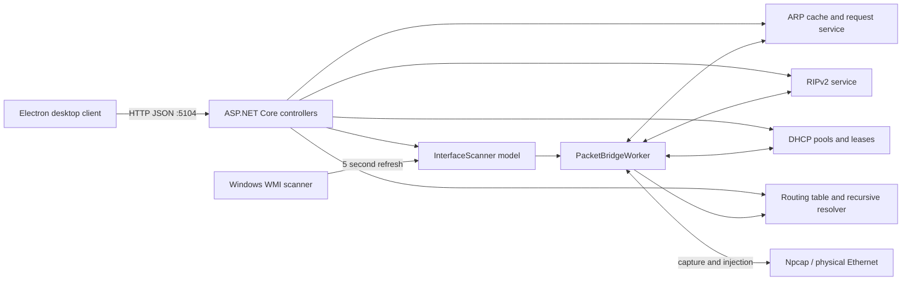

<h1 align="center">Router · Server</h1>

<p align="center"><strong>An IPv4 routing lab with a REST management API.</strong></p>

<p align="center">
  Forward Ethernet traffic, manage routes, and explore ARP, RIPv2, and DHCP with the WANT software router.
</p>

<p align="center">
  <a href="#getting-started">Getting started</a> ·
  <a href="#using-the-router">Using the router</a> ·
  <a href="#api-reference">API reference</a> ·
  <a href="#network-behavior">Network behavior</a> ·
  <a href="#development">Development</a> ·
  <a href="https://github.com/Gh0st3r0k/ROUTER-CLIENT">Desktop client</a>
</p>

<p align="center">
  
  
  
  
</p>

---

## Overview

WANT Router Server is an educational IPv4 software router built with **ASP.NET Core 9**, **SharpPcap**, and **PacketDotNet**. It processes Ethernet frames in user space and exposes a REST API for the companion [Router Desktop](https://github.com/Gh0st3r0k/ROUTER-CLIENT) client.

| Component | Behavior |
| --- | --- |
| Interface management | Discovers active physical Ethernet adapters on Windows every five seconds; stores a display name and user-configured IPv4 address/mask in the router model. |
| IPv4 forwarding | Resolves routes recursively, decrements TTL, updates the IPv4 header checksum, resolves the next-hop MAC with ARP, and injects a new Ethernet frame. |
| Routing table | Longest-prefix lookup; lower administrative distance wins for the same exact network/prefix. Direct routes default to distance 0, static next-hop routes to 1, and RIP routes to 120. |
| ARP | Learns replies, answers for configured router addresses, supports per-interface Proxy ARP, sends explicit requests, and exposes cache inspection, TTL, and flush operations. |
| RIPv2 | Per-interface enable/disable, multicast updates, received route learning, split horizon, configurable update/invalid/holddown/flush timers. |
| DHCP | Interface-bound pools, manual reservations, automatic permanent allocation, dynamic leases, DISCOVER/OFFER, REQUEST/ACK, RELEASE, and expired-lease cleanup. |
| Management | REST controllers, permissive CORS for the desktop client, and Swagger UI/OpenAPI. |

See [API reference](docs/api.md) for request shapes and [network behavior](docs/networking.md) for packet handling and protocol limitations.

> Full packet routing targets **Windows with Npcap and physical Ethernet adapters**. Linux supports builds, automated tests, and management API development; Windows adapter discovery is intentionally skipped there.

## Getting started

### Requirements

- .NET **9 SDK** to build and test; the ASP.NET Core 9 runtime to run built outputs.
- Windows with [Npcap](https://npcap.com/) and packet capture/injection access for the full router workflow. Install its WinPcap compatibility support when required by your setup.
- Two or more suitable physical Ethernet adapters and separate lab networks to demonstrate forwarding between networks.
- Administrator privileges if required by the Npcap installation policy.
- NuGet access for restore. No database, API key, or external application service is required.
- Optional: Node.js 22+ and the companion Electron client for the desktop management UI.

The project references Microsoft.AspNetCore.OpenApi 9.0.9, Swashbuckle.AspNetCore 9.0.4, PacketDotNet 1.4.8, SharpPcap 6.3.1, and System.Management 9.0.9.

### Installation and startup

```sh
git clone https://github.com/Gh0st3r0k/Router-Server.git
cd Router-Server
dotnet restore WANT.sln
dotnet build WANT.sln --configuration Release
dotnet run --project Server/Server.csproj --launch-profile http
```

The `http` launch profile binds to `http://localhost:5104`, matching the desktop client's preload bridge. Swagger UI is served at `/swagger`; the machine-readable specification is `/swagger/v1/swagger.json`.

For a built application without launch profiles:

```sh
dotnet Server/bin/Release/net9.0/Server.dll --urls http://localhost:5104
```

Start the desktop client from its own checkout with `npm ci` followed by `npm start`. See its README for desktop/headless prerequisites.

## Using the router

1. Start the server on the Windows lab host and confirm adapters appear in `GET /api/interface`.
2. In the client, open **Ports** and configure each router-model IPv4 address and contiguous mask.
3. Add connected routes from the main window, then add any required static next-hop routes.
4. Configure hosts on each attached subnet to use the corresponding router-model address as their gateway.
5. Enable RIP or configure DHCP pools only on the intended lab interfaces. Review [network behavior](docs/networking.md) before interpreting packet captures.

Use this software on an isolated lab network. The API has no authentication or authorization and permits any CORS origin; keep it bound to loopback or a trusted management network.

## Architecture



Interface addresses belong to the application's model: setting an address through the API does **not** configure the host operating system. Routes, protocol settings, ARP entries, pools, reservations, and leases are held in memory and are lost when the process restarts.

## API reference

Browse the running server's Swagger UI at `/swagger`, or read the [API reference](docs/api.md) for all management endpoints, request bodies, response formats, and examples.

## Network behavior

Read [Packet flow and network behavior](docs/networking.md) for IPv4 forwarding, recursive route resolution, ARP, RIPv2, DHCP, and the hardware validation boundary.

## Development

### Project layout

```text
WANT.sln
Server/
  Program.cs                 Dependency injection, hosted services, CORS, Swagger
  Controller/                Interface, route, ARP, RIP, and DHCP endpoints
    dto/                     Request models and IPAddress JSON conversion
  Services/
    Interfaces/              Windows discovery and immutable interface snapshots
    Packets/                 Capture, forwarding, ARP cache and packet construction
    Routing/                 Route storage, preference, recursive resolution
    Rip/                     RIPv2 packets, learned routes, timers
    Dhcp/                    DHCP packets, pools, reservations, leases
  Properties/launchSettings.json
Server.Tests/                Hardware-independent regression tests
docs/                        API and networking reference
```

`bin/`, `obj/`, test outputs, IDE state, and local environment files are ignored. Historical build outputs are no longer tracked.

### Testing

```sh
dotnet test WANT.sln --configuration Release
```

The xUnit suite covers route replacement and preference, longest-prefix boundaries, recursive next-hop resolution and loop termination, connected routes from configured interfaces, serialized ARP request fields, and RIPv2 learning/withdrawal/invalid metrics. Tests require neither Npcap nor physical hardware. GitHub Actions runs this command on Linux.

For an API smoke check against a running instance:

```sh
curl --fail http://localhost:5104/swagger/v1/swagger.json
curl --fail http://localhost:5104/api/routes
curl --fail http://localhost:5104/api/rip/timers
curl --fail http://localhost:5104/api/dhcp/settings
```

The companion client also includes an end-to-end smoke command that exercises the API through an actual Electron preload bridge. Unit tests and HTTP responses do not establish that frames were forwarded on real Ethernet hardware.

## Limitations and troubleshooting

| Symptom | Explanation / action |
| --- | --- |
| Empty interface list on Linux | Expected: discovery uses Windows WMI and is skipped on other operating systems. API and unit-test development still work. |
| No Windows adapters | Check that the adapter is Ethernet, physical, connected, and up. Check WMI access and Npcap installation; virtual/Wi-Fi adapters are not the discovery target. |
| Capture device cannot be opened | Check Npcap compatibility support, device availability, and capture privileges. |
| Client cannot connect | Confirm the server is listening on port 5104 and that the client runs on the same host; its API base URL is currently fixed. |
| First forwarded packet disappears | On an ARP miss, the router sends an ARP request and drops the triggering packet. It does not buffer packets while resolving neighbors. |
| State disappears after restart | State is in memory; there is no configuration or lease persistence. |
| RIP/default route differs from a commercial router | This is a limited RIPv2 implementation; see the protocol-specific limitations in the networking reference. |
| .NET fails on a read-only cloud home | Set writable `DOTNET_CLI_HOME`, `NUGET_PACKAGES`, and a private `XDG_RUNTIME_DIR`; the latter is used by the .NET runtime's named mutex implementation. |

IPv6 forwarding, NAT, a firewall, DHCP relay, durable configuration, and a production-grade routing protocol implementation are not provided. Physical forwarding, Proxy ARP interoperability, real DHCP client allocation, and RIPv2 convergence require a Windows/Npcap hardware lab and were not validated by the Linux checks.
