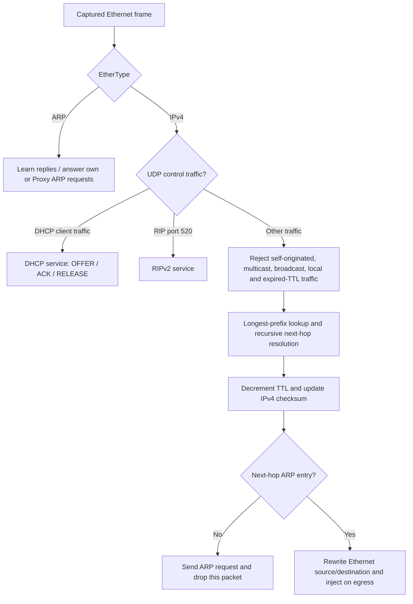

# Packet flow and network behavior

## Interface model

On Windows, `PortScannerWorker` refreshes physical, connected, up Ethernet adapters every five seconds using WMI and `NetworkInterface`. `InterfaceManager` preserves user display names and configured router-model addresses across refreshes. Missing adapters are removed from the model; the capture worker opens and closes devices in response to snapshot changes. The OS address configuration is never changed by these operations.

The capture filter is `arp or ip`, with promiscuous capture. The forwarding path operates directly on Ethernet frames through SharpPcap/Npcap; it does not install routes in the operating system's routing table.

## IPv4 forwarding

The routing table retains one entry per exact destination/prefix. Lower administrative distance takes precedence; equal-distance updates replace the previous entry. Lookup prefers a longer matching prefix. There is no ECMP. Recursive next-hop resolution stops at a direct route, fails on a missing route, and has an eight-lookup limit to bound cycles. The resolved neighbor address is used for ARP, while the original IPv4 destination remains unchanged.

Packets addressed to the router itself are not handled as a general local IP stack. TTL-expired packets are dropped without generating ICMP Time Exceeded. The forwarding path does not implement NAT, firewall policy, IPv6, ICMP error generation, or packet buffering during ARP resolution.

## ARP

The server ignores replies sourced from its own interface MAC/address, learns valid reply senders, and answers requests for configured router-model addresses. Proxy ARP is enabled by default and can be toggled per interface; it uses routing information to answer for reachable destinations behind another interface.

The default dynamic cache lifetime is 120 seconds; a timer purges expired entries every five seconds. Changing the configured TTL affects subsequent learning rather than rewriting every stored expiration. The cache is keyed by IP, and lookups additionally check the interface ID. Consequently, overlapping address spaces on multiple interfaces are not independently represented. Forwarding lookups do not check expiration until the janitor removes an entry, so an expired entry may remain usable briefly between cleanup ticks. These existing semantics are retained by the cleanup.

## RIPv2

- RIP is disabled until explicitly enabled on an interface.
- Updates use UDP port 520 and multicast `224.0.0.9`.
- Received IPv4 routes with metrics 1–15 are installed at administrative distance 120; metric 16 withdraws a learned route.
- The sender address is used as next hop; the advertised next-hop field is not used for recursive neighbor selection.
- Updates advertise connected networks on other interfaces and learned RIP networks, applying split horizon and incrementing learned metrics up to 16.
- Defaults: update 30 s, invalid 180 s, holddown 180 s, flush 240 s. Timer processing handles invalidation, holddown, and removal.

This is a teaching implementation rather than a complete interoperable RIP daemon. It does not provide authentication, equal-cost paths, full route selection between competing neighbors, or complete RFC behavior. Received zero network/mask entries are skipped, so default-route learning is not supported. Static routes are not generally redistributed by the update builder. Validate convergence, withdrawals, packet sizes, and interoperability with real neighbors before relying on them.

## DHCP

The service selects an enabled pool bound to the ingress interface. Reservations take precedence when manual allocation is enabled; otherwise automatic allocation precedes dynamic allocation. Automatic/manual assignments have no expiration in the lease table; dynamic assignments use a pool override or the global lease duration. Free-address selection excludes active leases and reserved addresses. The background worker removes expired dynamic leases.

DISCOVER produces an OFFER without committing a lease. REQUEST checks the requested address (option 50, reservation, or renewal `ciaddr`), checks range/network and conflicting live leases, records the lease, and produces an ACK. RELEASE removes the client's lease and produces no reply. Invalid/conflicting requests are ignored; the server does not send DHCP NAK. Replies contain message type, subnet mask, router, lease time, and server identifier options. New allocations are broadcast; renewal ACKs with `ciaddr` are unicast to the client MAC.

There is no DHCP relay, persistence, DNS option configuration, DECLINE/INFORM processing, or complete malformed-packet/options validation. Multiple overlapping pools and arbitrary invalid pool configurations are not robustly validated. Permanent server-side assignments still receive a lease-time option in replies. Use a single well-formed scope per lab interface and test actual client behavior.

## Validation boundary

Automated tests exercise in-memory route decisions, configured interface networks, ARP serialization, and synthetic RIPv2 messages. Linux API/client smoke checks exercise JSON contracts and desktop integration. They do not capture or inject real traffic.

A Windows/Npcap lab is required to verify adapter discovery, capture privileges, own-address ARP, Proxy ARP across interfaces, IPv4 forwarding and TTL/checksums on the wire, RIPv2 exchanges/convergence, and DHCP allocation/renewal/release with real clients. Capture both ingress and egress traffic and distinguish a control-plane API response from successful data-plane forwarding.
